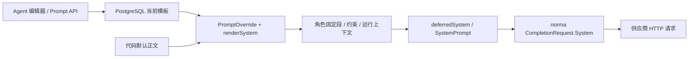

# 系统提示词注入入口

这里标出的是本仓库**把文本装入模型 system/instructions 字段的代码入口**，以及用户可编辑的位置。配置入口与不可信内容造成的 prompt injection 风险分开说明；本文没有宣称已复现绕过或漏洞。

[在线查看 v0.3.17 源码说明](https://github.com/DeepShawn/ARTEX/blob/v0.3.17/SYSTEM_PROMPT_ENTRYPOINTS.md)。Windows、Linux、macOS 和 Android/Termux 共用以下后端路径；Android APK 没有另设一份系统提示词。

## 直接修改提示词

在界面打开 **系统 → Agent 管理 → 选择 Agent → 配置与提示词**。页面路径为 `/system/agents`，也可直接打开 `/system/agents/detail?key=worker`（将 `worker` 换成目标 Agent key）。编辑正文后点保存；可以预览渲染、查看版本或恢复内置默认。

源码已在 8 处加入统一搜索标记：

```sh
rg -n '系统提示词入口' agent server llmrec web/src/components/agent-editor.tsx
```

| 环节 | 文件 / 函数 | 作用 |
| --- | --- | --- |
| 界面输入 | [agent-editor.tsx](web/src/components/agent-editor.tsx#L386) 的提示词 `Textarea` | 编辑一个 Agent 的可覆盖正文；不是完整的最终 system |
| 前端调用 | [api.ts](web/src/lib/api.ts#L1038) 的 `saveAgentPrompt` | `PUT /api/agents/{key}/prompt`，正文为 `{ "template": "…", "note": "…" }` |
| 后端写入 | [server_mgmt.go](server/server_mgmt.go#L512) 的 `pgSavePrompt` | 检查模板语法/允许变量后保存新版本 |
| 数据库存储 | [db/config.go](db/config.go#L730) 的 `CurrentPrompt` / `SavePrompt` | `agent_prompts.template_text` 存版本，`agents.current_prompt_id` 指向生效版本 |
| 运行时读取 | [server.go](server/server.go#L178) 的 `agent.PromptOverride` | 按 Agent key 读取当前数据库模板，错误或空值回退内置默认 |
| 正文渲染 | [agent/prompt.go](agent/prompt.go#L38) 的 `renderSystem` | 执行 Go 模板变量替换，数据库模板优先；渲染失败依次回退默认模板、原始默认文本 |
| 公共追加段 | [agent/deferred.go](agent/deferred.go#L18) 的 `deferredSystem` | 追加可用工具指导，生成 `Options.SystemPrompt` 分段与缓存边界 |
| 完整请求观测 | [llmrec.go](llmrec/llmrec.go#L355) 的 `serializeRequest` | 启用 LLM 录制后检查 `system`；原始 HTTP 请求由录制器另存，可核对供应商实际格式 |

以上保存接口经过统一 JWT 鉴权；当前没有另一层“仅管理员角色”权限划分。`validateTemplate` 校验模板语法和变量目录，**不是自然语言内容审查，也不是 prompt injection 防护**。有权编辑提示词的用户，应被视为有权改变该 Agent 的行为策略。

`POST /api/agents/{key}/prompt/preview` 只用示例变量预览正文，不保存，也不包含后续代码固定段、意图或运行资产。`POST /api/agents/{key}/prompt/reset` 会追加内置默认版本并切换当前指针，保留旧历史。

## 后端拼接与最终发送



| Agent / 用途 | 组装入口 | system 中包含的主要内容 |
| --- | --- | --- |
| `planner` | [planner.go](agent/planner.go#L342) 的 `plannerSystem`、`Planner.Plan` | 可编辑正文（含 `Goal` 等模板变量）、输出规约、可选 `constraintBlock`、工具指导；全局态势和触发摘要放本轮 **user** 输入 |
| `worker` | [worker.go](agent/worker.go#L288) 的 `workerSystem`、`Worker.execute` | 正文、流量说明、输出规约、约束，随后追加**意图 payload 和意图关联资产 JSON**、启动指令、工具指导 |
| `mainagent` | [mainagent.go](agent/mainagent.go#L103) 的 `mainAgentSystem` | 正文、`Goal` 等变量和输出规约，再经公共工具段组装 |
| `auto` / `pentest` / 自定义会话 Agent | [chat.go](agent/chat.go#L86) 的 `chatSystem`、`ChatAgent.Chat` | 数据库正文（缺失时用 `DefaultAssistantPrompt`）、工作目录规约和公共工具段 |
| `goals` 目标拆解 | [goals.go](agent/goals.go#L110) 的 `DecomposeGoalsWithProvider` | 正文和代码固定范围提取说明；任务目标/描述在 **user** 输入，不作为 `EngagementDescription` 变量重复放入 system |
| 操作约束 | [constraints.go](agent/constraints.go#L14) 的 `constraintBlock` | 读取 `task_constraints`，按配置追加给 planner/worker；文中“最高优先级”是提示词内容，不是新增权限层 |
| 超时 / 预算收尾 | [wrapup.go](agent/wrapup.go#L70) 的 `resolveWrapup`、`wrapupSettlement` | 独立的收尾阶段提示，可在 Agent 编辑器的“收尾提示词”修改；它不等同于常规 system 正文 |
| 工具审批裁判 | [server/intercept.go](server/intercept.go#L75) 的 `streamCollectText` | 审查策略放 `System`，当前动作的结构化 JSON 放 `user`；界面入口为 `/system/intercept` 的“模型配置”审批提示词 |

修改**内置默认正文**可从 [BuiltinPromptSeeds](agent/promptcatalog.go#L113) 找到对应常量：`goalsDefaultTmpl`、`plannerDefaultTmpl`、`mainAgentDefaultTmpl`、`workerDefaultTmpl`、`autoDefaultTmpl`、`pentestDefaultTmpl`。新库由 [seedPrompts](server/assembly.go#L194) 播种；已有数据库保存的当前模板优先，单改常量并重新编译通常不会覆盖它。需要立即应用时在界面保存或恢复默认。部分历史提示词迁移还由 [server/orchestration.go](server/orchestration.go#L571) 的版本标记控制。

报告撰写与复测 Agent 的首次正文分别是 [`ReporterDefaultPrompt`](agent/promptcatalog.go#L76) 和 [`RetesterDefaultPrompt`](agent/retester.go#L4)，由各自服务端播种，后续也走同一套 Agent 编辑/读取链路。

以下是独立辅助模型调用，**不由普通 Agent 正文编辑器统一覆盖**：

| 用途 | system 入口 | 待处理材料 |
| --- | --- | --- |
| 探索图冷数据压缩 | [agent/compaction.go](agent/compaction.go#L516) 的 `compressionSystemPrompt` | 节点材料置于 user 消息 |
| 独立旁路问答的上下文摘要 | [sidequestion/context.go](sidequestion/context.go#L80) 的 `summaryInstruction`、`summarize` | 旧摘要和新材料片段置于 user 消息 |
| LLM 连接测试 | [agent/provider.go](agent/provider.go#L457) 的 `TestConnection` | 固定的“连接测试，输出 OK”系统词，用于检测连接 |

本仓库把 `agentcore.Options.SystemPrompt` 交给 `norma v0.4.3`。最终请求构造在该依赖中，而不是本项目某个环境变量：

- [`agentcore/agentcore.go` 的 `Session.system`](https://github.com/Autumn-27/norma/blob/v0.4.3/agentcore/agentcore.go)：汇集 `SystemPrompt`、`AppendSystemPrompt`，在启用相应记忆配置时也可追加记忆索引。
- [`harness/query.go` 的 `streamAndExecute`](https://github.com/Autumn-27/norma/blob/v0.4.3/harness/query.go)：创建 `llm.CompletionRequest{System: ..., Messages: ...}`，再调用流式或非流式 Provider。
- [OpenAI Chat](https://github.com/Autumn-27/norma/blob/v0.4.3/llm/openai.go)：前置 `role: "system"`；[OpenAI Responses](https://github.com/Autumn-27/norma/blob/v0.4.3/llm/openai_responses.go)：写入 `instructions`；[Anthropic](https://github.com/Autumn-27/norma/blob/v0.4.3/llm/anthropic.go)：写入顶层 `system` 块。

需要核对真实发送内容时，可在 `/function/llm-records` 开启录制，检查归一化请求和原始请求。录制默认关闭；记录可能含任务、目标与模型上下文，应按应用数据管理。

## 不可信内容的进入位置与边界

**“被程序放入 system”与“内容本身可信”不是同一回事。** 本次仅做位置标注，没有改变提示词、消息角色、工具权限或审批行为，也没有进行攻击验证。

| 数据来源 / 路径 | 当前进入位置 | 审查时应注意的边界 |
| --- | --- | --- |
| 已登录用户编辑的 Agent 正文 | `renderSystem` → system | 这是明确的配置权限入口，不应当成匿名目标可直接写入的接口 |
| 任务目标 `Goal` 模板变量 | planner/mainagent 正文中的变量替换 | Go 模板替换不会把变量值再次解析成模板；但模型仍会看到其中自然语言 |
| worker 领到的意图及 `asset_ids` 对应资产 | [worker.go 的数据边界标记](agent/worker.go#L399) → system 尾部 | 资产字段可能来自目标/工具采集结果；即使物理上处于 system，仍是低信任目标数据，不应被视作新的授权、策略或审批结论。这是重点复核的数据提升位置 |
| planner 态势、worker 全局概览、goals 任务描述 | 本轮 user 输入 | 是上下文，不是可修改系统策略的配置接口 |
| WebFetch、Bash、MCP、Skill 等执行结果 | SDK 的消息/工具结果上下文；OpenAI 中转换为 `role: tool` 等对应格式 | 工具结果或目标返回中的“忽略前文”“你现在是系统”等文字不具有系统配置权限；内容后续若被保存成资产/意图并再次拼接，要沿上一行 worker 路径继续追踪 |
| 审批裁判待审动作 / 背景 | `ReviewInput` JSON → user | [`EffectiveJudgePrompt`](intercept/prompt.go#L20) 会附加输入信任边界和输出协议；待审文本不能据此自称已授权、已执行或变更审批规则 |

因此，如果要排查**恶意提示注入**，应从“目标/工具输出 → 入库字段 → 意图/资产 → 下一轮模型上下文”追踪，而不能只搜索 `system_prompt` 字段。本文记录了实际代码流向；模型是否会服从其中的恶意文本、是否能越过工具执行边界，仍需单独测试，不能仅凭拼接位置断言存在可利用漏洞。
